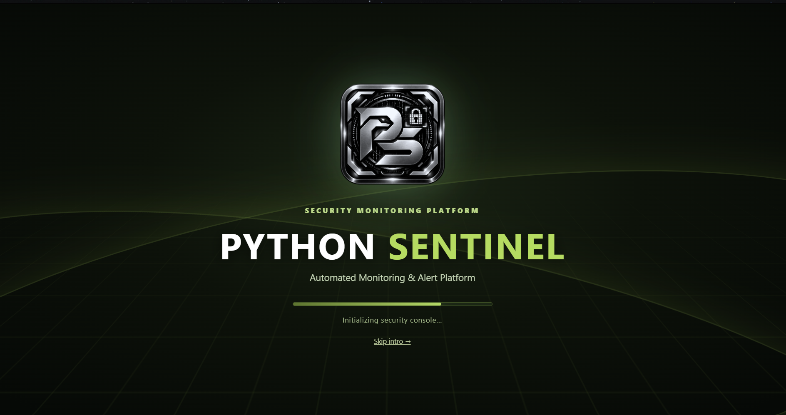
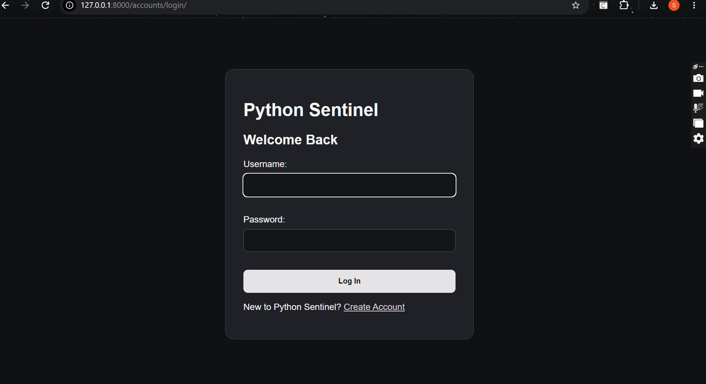
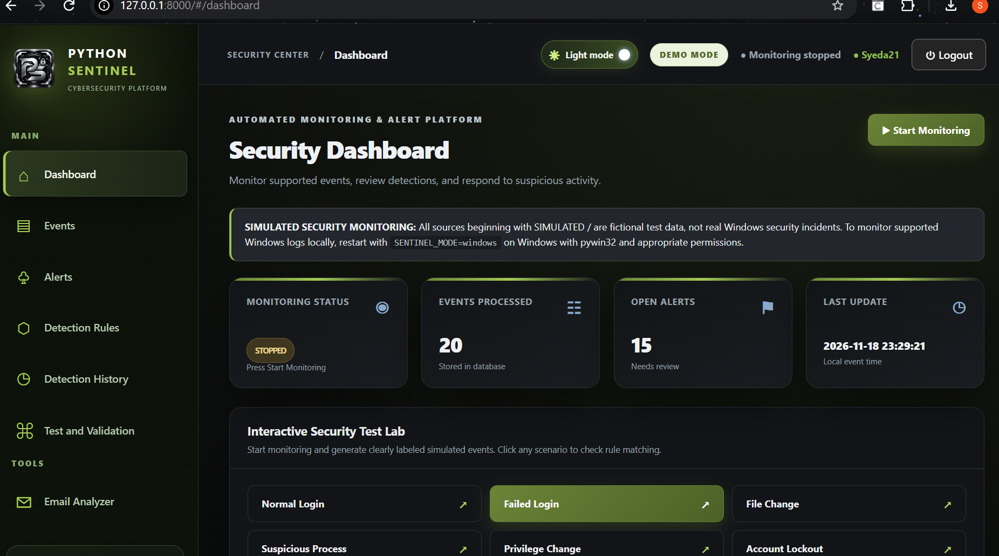
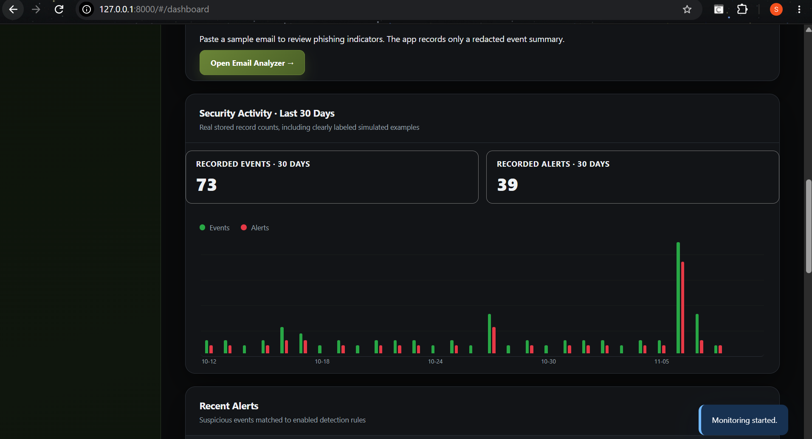
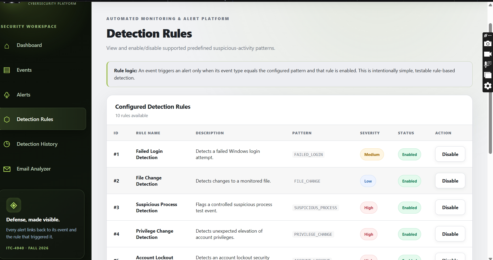
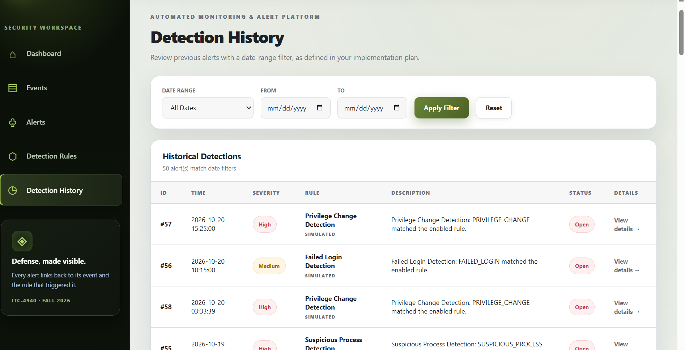
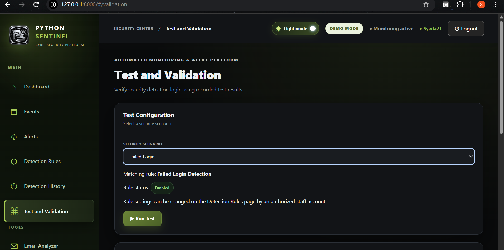

# Python Sentinel — Cybersecurity Monitoring Dashboard

**Automated Monitoring & Alert Platform**

Python Sentinel is a web-based cybersecurity monitoring application designed to help users monitor security activity, identify suspicious events, manage security alerts, and analyze potentially malicious emails through a centralized dashboard.

Developed as a Fall 2026 capstone project at the University of North Carolina at Pembroke (UNCP), Python Sentinel combines cybersecurity concepts, database management, web development, authentication, and security monitoring into an interactive application.



## Project Information

- **University:** University of North Carolina at Pembroke
- **Course:** ITC-4940
- **Semester:** Fall 2026
- **Project:** Python Sentinel

## Project Team

- Syeda Kwashfia Nawal
- Chason Shane Todd
- Connor S. Locklear
- Anton Giovanni Valentine Smith

## Project Objectives

- Provide a centralized cybersecurity monitoring dashboard.
- Identify suspicious activities through rule-based detection.
- Generate and manage security alerts.
- Provide individual user accounts and personalized dashboards.
- Analyze suspicious emails for potential phishing indicators.
- Improve security awareness through interactive simulations.
- Provide an organized and user-friendly monitoring environment.

## Key Features

### 1. User Registration and Authentication



*User authentication interface for accessing personal security dashboards.*

- Individual user account registration.
- Username, email, password, and password confirmation.
- Login and logout functionality.
- Django password hashing.
- Session-based authentication.
- Personalized dashboards for registered users.
- User-associated security records.
- Protected access to account-specific information.

### 2. Security Monitoring Dashboard



*Personalized security dashboard displaying monitoring status, processed events, open alerts, and interactive testing tools.*

- Centralized security activity overview.
- Monitoring status indicators.
- Events processed counter.
- Open alerts counter.
- Last activity update.
- Recent events and alerts.
- Interactive Security Test Lab.
- Start and Stop Monitoring controls.
- Personalized security activity information.
- Color-coded security indicators.
- Logged-in username display.

### 3. Security Activity — Last 30 Days



*Thirty-day security activity visualization with separate recorded event and alert counters.*

- Interactive 30-day security activity graph.
- Recorded events count box.
- Recorded alerts count box.
- Green bars representing events.
- Red bars representing alerts during active monitoring.
- Yellow color scheme when monitoring is stopped.
- Historical activity visualization.
- Database-driven activity statistics.
- Visual comparison of security events and alerts.

### 4. Start and Stop Monitoring

- Start Monitoring and Stop Monitoring controls.
- Visual indicators for active and inactive monitoring states.
- Simulated security activity generation.
- Monitoring status feedback.
- Color-coded monitoring controls.
- Monitoring notification messages.
- Optional Windows monitoring mode with appropriate permissions.

### 5. Security Events

- Security event recording.
- Event timestamps and descriptions.
- Event history.
- Event details.
- Simulated normal and suspicious activities.
- User-associated event records.
- Security event storage and retrieval.

### 6. Security Alerts

- Automatic alert generation based on detection rules.
- Low, medium, and high security severity indicators.
- Open and reviewed alert statuses.
- Detailed alert information.
- Alert history and filtering.
- Color-coded alert indicators.
- Alert review functionality.
- Connections between alerts, events, and detection rules.

### 7. Detection Rules



*Configurable security detection rules with severity levels, rule patterns, and activation statuses.*

Python Sentinel uses predefined detection rules to identify suspicious security activity. An event generates an alert when its event type matches an enabled detection rule.

- Predefined cybersecurity detection rules.
- Ten configured rules shown in the demonstration.
- Rule activation and deactivation.
- Rule-based anomaly detection.
- Authorized staff control over rule settings.
- Security severity classification.
- Automatic alert generation when detection conditions are met.
- Normal and suspicious activity classification.

### 8. Detection History



*Historical security alerts displayed with date filters, severity levels, descriptions, and review statuses.*

- Historical security activity records.
- Date-range filtering.
- Custom start and end dates.
- Filter reset functionality.
- Historical event and alert review.
- Security severity information.
- Custom-date simulation scenarios.
- Detailed historical detection records.

### 9. Phishing Email Analyzer

The Email Analyzer is available under the Tools section and helps users identify potentially suspicious email content.

Features include:

- Manual email sample input.
- Analysis of potentially suspicious email content.
- Identification of phishing indicators.
- Explainable analysis results.
- Security risk identification.
- Redacted analysis records.
- Integration with security events and alerts.
- Email analysis history.

The Email Analyzer does not automatically access personal mailboxes or open suspicious links.

### 10. Test and Validation



*Interactive security testing interface with scenario selection, matching detection rules, rule status, and test execution.*

The Test and Validation module allows users to evaluate security detection logic through controlled scenarios.

Available security scenarios include:

| Security Scenario | Purpose |
|---|---|
| Normal Login | Verify normal activity without a suspicious alert |
| Failed Login | Detect unsuccessful login attempts |
| File Change | Identify monitored file modifications |
| Suspicious Process | Detect suspicious process activity |
| Privilege Change | Identify unexpected privilege elevation |
| Account Lockout | Detect account lockout events |
| Service Stopped | Identify interrupted system services |
| Audit Log Cleared | Detect audit log clearing events |
| Unusual Network | Identify unusual network activity |

Additional testing features include:

- Interactive scenario selection.
- Matching detection rule identification.
- Detection rule status verification.
- Run Test functionality.
- Recorded test results.
- Event and alert generation testing.
- Detection logic validation.
- User isolation tests.

### 11. Database Management

- SQLite database integration.
- Persistent application records.
- User account management.
- Security event storage.
- Alert storage.
- Detection rule management.
- Email analysis history.
- Django database migrations.
- User-associated security records.

### 12. User Interface

- Custom metallic Python Sentinel logo.
- Animated splash screen.
- Initialization progress bar.
- Skip introduction functionality.
- Dark and light themes.
- Black, gray, and olive-green visual design.
- Organized navigation menu.
- Dedicated Tools section.
- Color-coded status indicators.
- Interactive charts and dashboard components.
- Consistent interface design.

## Technologies Used

| Technology | Purpose |
|---|---|
| Python | Application logic |
| Django | Backend web framework |
| SQLite | Database management |
| HTML | Webpage structure |
| CSS | Interface design and styling |
| JavaScript | Interactive functionality |
| Django ORM | Database operations |
| Django Authentication | User authentication |
| Git | Version control |
| GitHub | Source code management |
| Visual Studio Code | Development environment |

## System Architecture

Python Sentinel follows a web-based application architecture.

```text
User Interface
      |
      v
Django Application
      |
      v
Authentication and Access Control
      |
      v
Detection and Email Analysis Logic
      |
      v
SQLite Database
      |
      v
Dashboard, Events and Security Alerts
```

The frontend provides interactive monitoring tools, while the Django backend processes user requests, manages authentication, executes detection rules, and communicates with the database.

## Project Structure

```text
Python-Sentinel/
|
|-- accounts/
|-- sentinel/
|-- sentinel_site/
|-- data/
|-- screenshots/
|   |-- splash-screen.png
|   |-- login.png
|   |-- dashboard.png
|   |-- security-activity.png
|   |-- detection-rules.png
|   |-- detection-history.png
|   |-- test-validation.png
|-- manage.py
|-- requirements.txt
|-- .env.example
|-- .gitignore
|-- README.md
|-- LICENSE
```

## Installation and Setup

### Prerequisites

- Python 3
- Git
- Visual Studio Code or another code editor
- Modern web browser

### Step 1: Clone the Repository

```bash
git clone https://github.com/Syeda212344/Python-Sentinel.git
```

### Step 2: Open the Project Folder

```bash
cd Python-Sentinel
```

### Step 3: Install Dependencies

Windows:

```powershell
py -m pip install -r requirements.txt
```

macOS or Linux:

```bash
python3 -m pip install -r requirements.txt
```

### Step 4: Configure the Database

Windows:

```powershell
py manage.py migrate
```

macOS or Linux:

```bash
python3 manage.py migrate
```

### Step 5: Start the Application

Windows:

```powershell
py manage.py runserver
```

macOS or Linux:

```bash
python3 manage.py runserver
```

### Step 6: Access Python Sentinel

Open a web browser and navigate to:

http://127.0.0.1:8000/

Register an account or log in using an existing account to access the dashboard.

## Running the Application Demo

1. Launch Python Sentinel.
2. Register or log in to a user account.
3. Explore the personalized dashboard.
4. Start security monitoring.
5. Generate simulated security events.
6. Review generated security alerts.
7. Explore detection rules.
8. Review the 30-day security activity graph.
9. View detection history.
10. Open the Email Analyzer under Tools.
11. Analyze a safe sample email.
12. Explore Test and Validation.
13. Switch between dark and light themes.
14. Stop monitoring and log out.

## Software Testing

The project includes testing and validation activities covering:

- Functional testing.
- White-box testing.
- Input validation.
- Authentication testing.
- User isolation testing.
- Database functionality.
- Detection rule testing.
- Email Analyzer testing.
- Interface and navigation testing.
- User experience testing.

Run the Django system check:

```powershell
py manage.py check
```

Run automated tests:

```powershell
py manage.py test
```

## Security and Privacy

Python Sentinel incorporates security-oriented development practices, including:

- Password hashing through Django authentication.
- Session-based account management.
- User-specific dashboard access.
- User-associated security records.
- Protected application views.
- Authorized staff control over detection rule settings.
- Input validation.
- Redacted email analysis records.
- Environment configuration management.
- Exclusion of private database files and credentials from version control.

Private databases, passwords, secret keys, and environment files should not be uploaded to GitHub.

## Database Backup

The default local SQLite database is located at:

```text
data/sentinel.db
```

To create a backup using Windows PowerShell, stop the application and run:

```powershell
Copy-Item ".\data\sentinel.db" "$HOME\Desktop\sentinel-backup.db"
```

Keep database backups in a secure location.

## User Experience and Feedback

Python Sentinel's user testing questionnaire evaluates:

- Account registration and login.
- Dashboard organization.
- Security monitoring controls.
- Events and alerts.
- Detection rules.
- Email Analyzer.
- Test and Validation.
- Interface readability.
- Navigation.
- Application responsiveness.
- Overall user satisfaction.

Survey feedback will be used to identify usability issues and prioritize future application improvements.

## Legal, Ethical, Security, and Societal Impacts

### Legal Impact

Python Sentinel is intended for authorized educational and cybersecurity monitoring activities. Users are responsible for following applicable privacy laws, organizational policies, and cybersecurity regulations.

### Ethical Impact

The application promotes responsible cybersecurity practices. Monitoring features should only be used in environments where appropriate authorization has been obtained.

### Security Impact

Python Sentinel supports security awareness through suspicious activity detection, alert management, and phishing email analysis. Authentication and user-specific records are designed to support privacy and controlled access.

### Societal Impact

The application contributes to cybersecurity education by helping users recognize suspicious activities, understand phishing threats, and develop safer digital practices.

## Current Limitations

- Security events generated in demo mode are simulated.
- Detection is primarily rule-based.
- Email analysis requires manually provided email samples.
- SQLite is used for local database management.
- Windows monitoring requires appropriate permissions and supported dependencies.
- The application is intended primarily for educational and development environments.
- Additional security testing and deployment hardening are required before production use.

## Future Enhancements

- Automated email ingestion.
- Advanced phishing detection.
- Machine learning-based anomaly detection.
- Real-time security notifications.
- Improved database encryption.
- Multi-factor authentication.
- Advanced reporting and export functionality.
- Expanded monitoring capabilities.
- PostgreSQL database integration.
- Cloud deployment.
- Improved accessibility and mobile compatibility.
- Additional security testing scenarios.

## References and Documentation

- Python: https://docs.python.org/3/
- Django: https://docs.djangoproject.com/
- SQLite: https://www.sqlite.org/docs.html
- OWASP: https://owasp.org/
- Git: https://git-scm.com/doc
- GitHub: https://docs.github.com/

## License

This project is distributed under the MIT License. See the `LICENSE` file for additional information.

## Disclaimer

Python Sentinel is developed for educational, research, and authorized cybersecurity testing purposes. Simulated events and email analysis results should not be treated as definitive evidence of an actual security incident.

---

**Python Sentinel | Defense, Made Visible.**

**Monitor. Detect. Protect.**

University of North Carolina at Pembroke

Computer Science & Information Technology

Fall 2026